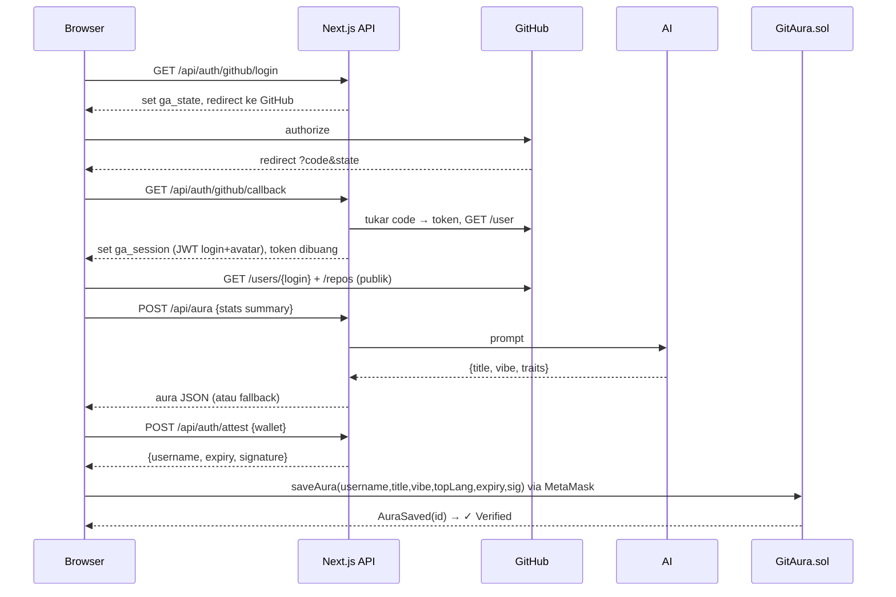

# Arsitektur GitAura

## 1. Gambaran sistem

```
┌──────────────── Browser (Next.js client) ────────────────┐
│  PromptBox · AuraCard · WalletButton · Gallery           │
│     │ fetch stats publik            │ ethers v6 (MetaMask) │
└─────┼───────────────────────────────┼────────────────────┘
      ▼                               ▼
 api.github.com              BOT Chain (GitAura.sol)
                                      ▲ getAura / total (read-only, JsonRpcProvider)
      │ /api/*                        │
┌─────▼──────── Next.js Route Handlers (Vercel, server) ───┐
│ auth/github/login · callback · me · logout               │
│ auth/attest  → signs with ATTESTER_PRIVATE_KEY           │
│ aura         → Gemini API (ringkasan stats saja)         │
└──────────────────────────────────────────────────────────┘
```

## 2. Alur utama (sequence)



## 3. Trust model
| Klaim | Siapa yang menjamin | Bagaimana |
|---|---|---|
| "Wallet 0x… milik @user" | Server (attester) + kontrak | Server hanya menandatangani `login` dari session OAuth; kontrak memverifikasi signer == `attester` dan `msg.sender` == wallet yang ditandatangani |
| Signature tidak bisa dipakai ulang di chain/kontrak lain | Kontrak | `block.chainid` + `address(this)` ada di digest |
| Signature tidak bisa dipakai selamanya | Kontrak | `expiry` (10 menit) |
| Isi `title`/`vibe` berasal dari AI | **Tidak dijamin di MVP** | Pemilik bisa mengubah teks sebelum tx. Upgrade opsional: tandatangani `keccak256(title, vibe)` (lihat CONTRACT_SPEC §6) |

## 4. Keputusan desain
1. **Route Handlers, bukan Worker terpisah** — satu deploy Vercel, satu domain; cookie session first-party (tanpa urusan CORS cookie lintas domain).
2. **Stats diambil di browser** — kuota rate limit GitHub ditanggung per pengunjung, server tidak butuh token GitHub.
3. **Tanpa database** — status login di JWT cookie; data aura di kontrak; riwayat lewat event.
4. **`abi.encode` untuk digest** — menghindari ambiguitas `encodePacked` dengan string dinamis.
5. **Username lowercase** — GitHub case-insensitive; normalisasi di server sebelum sign, kontrak menolak huruf besar.
6. **`topLang` sebagai uint8** — hemat gas; peta indeks → bahasa ada di satu tempat (`web/lib/config.ts`, tabel di CONTRACT_SPEC §5).

## 5. Ancaman & mitigasi
| Ancaman | Mitigasi |
|---|---|
| Login CSRF / forgery | `state` acak di cookie httpOnly, dibandingkan di callback |
| Mencuri session | Cookie `httpOnly`, `secure`, `sameSite=lax`, exp 2 jam, ditandatangani `SESSION_SECRET` |
| Minta signature untuk wallet orang lain | Tidak berguna: kontrak mewajibkan `msg.sender` == wallet di digest |
| Spam endpoint AI (biaya) | Origin check + rate limit 20/IP/jam + batas ukuran body |
| Prompt injection lewat nama repo/bio | Hanya angka & nama bahasa yang dikirim ke AI; output divalidasi zod + batas panjang |
| Kebocoran attester key | Key hanya di env server, wallet tanpa dana; jika bocor → deploy ulang kontrak dengan attester baru |
| String panjang (gas griefing) | Batas panjang di kontrak |

## 6. Keterbatasan yang diketahui (tulis di README)
- Rate limit in-memory tidak global di serverless (upgrade: Upstash Redis).
- `title`/`vibe` tidak ditandatangani di MVP.
- Galeri membaca semua id via RPC; untuk ribuan aura perlu indexer.
